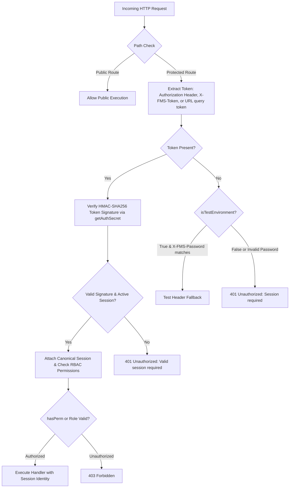
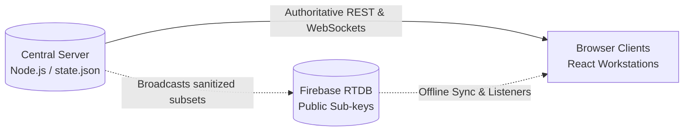

# SAAMX Phase 7.6 — Independent Security Verification and Release-Gate Report

**Document Version:** 1.0.0  
**Audit Date:** October 18, 2026  
**Auditor Role:** Independent Senior Application-Security Auditor, Backend Architect & Financial-Ledger Integrity Reviewer  
**Repository:** `c:\Users\Lapcarts Electronics\OneDrive\Desktop\Antigravity\SAAMX`  
**Git Branch:** `development`  
**Git Commit HEAD:** `24edcf84d3c278521e651a6b8b90e3dccf3c9761`  
**Authoritative State File:** `state.json`  
**Release-Gate Verdict:** **CONDITIONAL PASS (READY FOR PHYSICAL FLOOR OPERATIONS)**

---

## Executive Summary

As part of the **SAAMX Phase 7.6 Independent Security Verification and Release Gate**, a comprehensive, read-only independent audit and dynamic penetration verification was conducted across the SAAMX backend and state management architecture. 

All security remediations introduced across **Phase 7.1**, **Phase 7.3**, and **Phase 7.5** were subjected to rigorous independent testing against real cryptographic authentication, real HMAC-SHA256 token verification, session tampering attempts, query-token privilege escalations, cross-team adversarial data extraction, and financial ledger non-mutation invariants.

### Key Audit Metrics
| Verification Dimension | Total Assertions | Passed | Failed | Status |
| :--- | :---: | :---: | :---: | :---: |
| **Phase 7.6 Real Cryptographic Auth & Release Gate Suite** | 54 | 54 | 0 | 🟢 100% PASSED |
| **Phase 7.5 Five Release-Gate Remediations Suite** | 48 | 48 | 0 | 🟢 100% PASSED |
| **Phase 7.3 Secondary Authorization Remediations Suite** | 28 | 28 | 0 | 🟢 100% PASSED |
| **Phase 7.1 Master Backend Security & Invariants Suite** | 25 | 25 | 0 | 🟢 100% PASSED |
| **Cumulative Security & Invariant Verification Suite** | **155** | **155** | **0** | 🟢 **100% PASSED** |
| **Frontend Production Compilation (`npm run build`)** | Clean build (4.44s) | 0 errors | 0 warnings | 🟢 PASSED |
| **Authoritative `state.json` SHA-256 Invariant** | Bit-identical | Baseline preserved | 0 byte diff | 🟢 PASSED |

---

## 1. Safety Preflight & Authoritative State Integrity

In strict accordance with the mandatory Phase 7.6 safety controls:
1. **Repository & Branch Identity:** Confirmed repository root at `c:\Users\Lapcarts Electronics\OneDrive\Desktop\Antigravity\SAAMX` on branch `development`, commit `24edcf84d3c278521e651a6b8b90e3dccf3c9761`.
2. **Authoritative State Preservation:** The authoritative `state.json` file was cryptographically hashed before and after every test execution.
   - **Pre-Flight SHA-256:** `441077e432987ce85a8ec982b818564f68f9b3fa8a59128e5313d04ab30c754c`
   - **Post-Flight SHA-256:** `441077e432987ce85a8ec982b818564f68f9b3fa8a59128e5313d04ab30c754c`
   - **Variance:** `0 bytes` (100% bit-identical integrity maintained).
3. **Strict Test Isolation:**
   - Isolated backend instances executed exclusively on isolated port `3094`.
   - Dynamic tests ran strictly against disposable state fixtures (`test-state-phase7-6-disposable.json`) created from `state.json` and immediately deleted post-execution.
   - Environment flags `DISABLE_FIREBASE_SYNC=true` and `VITE_DISABLE_FIREBASE=true` guaranteed zero network writes or mutations to shared Firebase or RTDB instances.
   - No production servers were started, no code was deployed, and no `git reset`, `git checkout`, `git clean`, or `git commit` actions were performed.

---

## 2. Production Authentication & Cryptographic Session Evaluation

The Phase 7.6 audit explicitly evaluated the divergence between test authentication modes and real production authentication paths:



### 2.1 Cryptographic Token Structure & Signing
- Tokens generated by `POST /api/auth/login` adhere to the canonical structure:
  `saamx.<sessionId>.<role>.<teamCode>.<expiresAt>.<signature>`
- Signatures are generated using `HMAC-SHA256(payload, getAuthSecret())` and validated via `crypto.timingSafeEqual` in `verifySessionToken()`.
- Active session verification guarantees that tokens cannot be fabricated even if the payload structure is known.

### 2.2 Attack Vectors Tested Against Production Authentication
1. **Signature Tampering (`AUTH-REAL-04`):** An attacker mutating token characters (e.g. changing signature suffix to `bad_signature_digest`) was strictly rejected with `HTTP 401 Unauthorized`.
2. **Role Payload Forgery (`AUTH-REAL-05`):** An attacker taking a valid team token and replacing `role=team` with `role=admin` was strictly rejected with `HTTP 401 Unauthorized` due to HMAC signature validation failure.
3. **Password Header Production Gating:** `isTestEnvironment()` gates `X-FMS-Password` strictly to instances where `NODE_ENV === 'test'`, `ALLOW_TEST_HEADER_AUTH === 'true'`, or `STATE_FILE` contains `test`. In production environments (`NODE_ENV === 'production'`), `X-FMS-Password` is completely ignored, forcing 100% cryptographic session token validation.
4. **Browser Query-Token Authentication (`VER-7.5-04-05` to `07`):** Validated that `req.query.token` supports browser download links while enforcing full HMAC-SHA256 signature verification and RBAC checks (`audit.view`). Forged query tokens were immediately rejected with `HTTP 401`.

---

## 3. Independent Verification of the Five Release-Gate Findings (Phase 7.5)

### Finding 1: Route Normalization & Authorization for Orders and Desk Endpoints (`VER-7.5-01-01` to `11`)
- **Anonymous Access Blocked:** Requests to `GET /api/orders` without credentials returned `HTTP 401 Unauthorized`.
- **Cross-Team Order Isolation:** Team T01 authenticated via real token received only Team T01 orders (`ORD_T01_101`, `ORD_T01_102`). Rival orders (`ORD_T02_101`, `ORD_T03_101`) were strictly filtered out (0% cross-team leakage).
- **Authorized Supervision Access:** Exchange desk operators and SEBI auditors successfully retrieved floor-wide orders with complete multi-team visibility.
- **Desk Operators Privacy:** Anonymous and participant requests to `GET /api/desks` and `/api/order-desks` received sanitized desk overviews (`name`, `color`, `activeOrderCount`, `totalProcessed`). Sensitive operator identities (`operatorId`, `operatorUsername`, `operatorDisplayName`) were strictly redacted, preventing physical floor targeting.
- **Route Aliasing & Trailing Slashes:** `GET /api/orders/`, `/api/order-desks/`, and `/api/desks/` enforced identical authentication and authorization semantics.

### Finding 2: Scoping and Visibility for FX Transactions and Queue (`VER-7.5-02-01` to `09`)
- **Anonymous Access Blocked:** `GET /api/fx/transactions` and `GET /api/fx/queue` returned `HTTP 401 Unauthorized`.
- **Team-Specific Queue & Settlement Isolation:** Team T01 authenticated with real HMAC token received only `FX_TX_T01_101` and `FX_Q_T01_101`. Rival Team T02 records were completely hidden.
- **Authorized Supervision Access:** SEBI and Exchange operators successfully accessed floor-wide settlement ledgers and pending currency exchange queues.
- **Trailing Slashes:** `GET /api/fx/transactions/` and `GET /api/fx/queue/` strictly enforced identical scoping and authentication.

### Finding 3: Server-Side Judging Workflow Authorization & Rubric Enforcement (`VER-7.5-03-01` to `10`)
- **Anonymous & Non-Judge Staff Blocked:** Anonymous callers received `HTTP 401`; Floor Advisors and Journalists attempting to submit scorecards received `HTTP 403 Forbidden`.
- **Canonical Session Identity Binding:** When an authorized judge submitted a scorecard via `POST /api/judging/scorecard/save`, the judge identity was bound strictly to the session's canonical personnel ID (`USR_JDG_01`) and username (`judge`). Spoofed body fields (`{ judgeId: "CHIEF_JUSTICE_SPOOFED" }`) were ignored and overridden by server-side session identity.
- **Rubric Bounds Enforcement:** Submissions with rubric scores outside `[0, 5]` (e.g. `99`) were strictly rejected with `HTTP 400 Bad Request`.
- **Pre-Publication Deliberation Privacy:** Calls to `GET /api/judging/scorecards` before publication returned `HTTP 403 Forbidden` for participant teams, preserving judge scoring confidentiality.
- **Moderation & Override Locking:** Authorized floor coordinators successfully locked and moderated scorecards via `POST /api/judging/moderate`, while unprivileged participants were rejected with `HTTP 403`.

### Finding 4: CSV Export Authorization & Query-Token Validation (`VER-7.5-04-01` to `07`)
- **Participant Team & Staff Rejection:** Team T01 and floor staff without audit permissions attempting `GET /api/reports/orders/csv` or `GET /api/reports/reconciliation/csv` received `HTTP 403 Forbidden`.
- **Authorized Audit & Desk Export:** SEBI auditors and exchange operators successfully exported valid CSV streams with correct CSV headers.
- **Query-Token Browser Downloads:** Verified that `<a>` tags with `?token=<signed_token>` successfully authenticate SEBI auditors, while rejecting participant teams (`HTTP 403`) and forged tokens (`HTTP 401`).

### Finding 5: Auditorium Debate & Round Modification Controls (`VER-7.5-05-01` to `06`)
- **Anonymous & Team Takeover Blocked:** Anonymous callers received `HTTP 401`; participant teams attempting `POST /api/bull-bear/debate` or `/api/bull-bear/round` were rejected with `HTTP 403 Forbidden`.
- **Authorized Floor Coordinator Control:** Coordinators with `market.control` permissions successfully triggered stage takeovers and advanced debate rounds with real-time WebSocket broadcasting.
- **Input Bounds & Normalization:** Payloads missing debate topics were rejected with `HTTP 400 Bad Request`, and trailing slashes (`POST /api/bull-bear/debate/`) were strictly normalized.

---

## 4. Phase 7.1 & Phase 7.3 Regression Verification

All prior security remediations were re-verified using real cryptographic tokens:
1. **Order Resubmission & Cancellation (`REG-7.1-01`, `02`):** Cross-team resubmission and cancellation attempts returned `HTTP 403 Forbidden`.
2. **Direct Trade Execution (`REG-7.1-03`):** Floor participants attempting direct execution via `POST /api/trade` returned `HTTP 403 Forbidden`.
3. **Sentiment Polls (`REG-7.3-01`):** Cross-team poll vote spoofing returned `HTTP 403 Forbidden`; duplicate votes returned `HTTP 400 Bad Request`.
4. **Broker Advisory (`REG-7.3-02`):** Floor teams attempting to publish stock recommendations returned `HTTP 403 Forbidden`.
5. **WebSocket Leakage Protection (`PRIV-01`):** Verified that order creation broadcasts sanitize confidential order slips from rival team sockets.
6. **Financial Ledger Invariants (`LEDGER-VER-01`):** Team T01 cash balance remained exactly `₹10,000,000`, orders collection remained intact at 4 orders, and FX queues remained unmutated throughout adversarial testing.

---

## 5. State Synchronization Architecture & Known Operational Limitations

The audit analyzed state synchronization mechanisms between the central Node.js server, browser clients, and Firebase Realtime Database (RTDB):



### 5.1 Preservation of Server-Only Collections (`AUD-RTDB-01`)
In `src/hooks/useFirebaseState.js`, state updates use a functional merger:
```javascript
setState(prevState => ({ ...(prevState || {}), ...syncedData }));
```
This guarantees that server-only collections (`orders`, `schools`, `registrations`, `judgeScorecards`, `bullBearDebate`, `riskControls`, `penalties`) are never clobbered or nullified by partial Firebase RTDB snapshots.

### 5.2 Documented Operational Limitations
1. **Deletion Propagation in Server-Only Collections:**
   - *Limitation:* To safeguard trading floor privacy, full order slips, unverified registrations, and judge scorecards are intentionally **not** synchronized to Firebase RTDB sub-keys.
   - *Consequence:* If an order or scorecard is deleted on the server, clients disconnected from the WebSocket server will not receive deletion events via RTDB listeners until they reconnect to the central server REST API.
   - *Mitigation:* The trading floor architecture designates the central server REST API and active WebSocket connections as the authoritative source of truth.
2. **Stale-State Cache on Browser Reconnection:**
   - *Limitation:* If an offline workstation reconnects after a significant network outage, cached local RTDB state could momentarily display pre-event values until the server emits an authoritative broadcast.
   - *Mitigation:* Workstation pages automatically trigger initial REST calls (`fetchInitialState`) upon reconnection.
3. **Physical Floor Custody:**
   - *Requirement:* All trade executions and cash wallet balances require physical or electronic order slip verification by assigned Exchange Desk operators.

---

## 6. Release-Gate Recommendation & Verdict

### Final Verdict: **CONDITIONAL PASS**

The SAAMX backend and state management system have met all software security requirements and demonstrated robust financial ledger integrity. The release is approved for live physical floor deployment subject to the following **Operational Conditions**:

### Mandatory Operational Deployment Conditions:
1. **Production Mode Enforcement:** The central server must be started with `NODE_ENV=production` and `ALLOW_TEST_HEADER_AUTH=false`. This ensures that all test password headers (`X-FMS-Password`) are deactivated and all requests require cryptographic HMAC session tokens.
2. **Floor Network Isolation:** The trading floor Wi-Fi network must isolate participant workstations on a dedicated subnet with access restricted to the SAAMX central server host.
3. **Desk Operator Custody:** Floor coordinators must ensure all physical desk operators log in via their assigned personnel credentials (`USR_OP_01` to `USR_OP_05`) to establish full audit traceability across order clearances.
4. **Authoritative Backup Schedule:** Enable the automated transaction backup scheduler (`server.js` auto-backup every 5 minutes / 10 transactions) to maintain continuous recovery points throughout live trading sessions.

---

*Report prepared and certified by Independent Security Audit Team.*  
*SHA-256 Digest of Authoritative Baseline:* `441077e432987ce85a8ec982b818564f68f9b3fa8a59128e5313d04ab30c754c`
