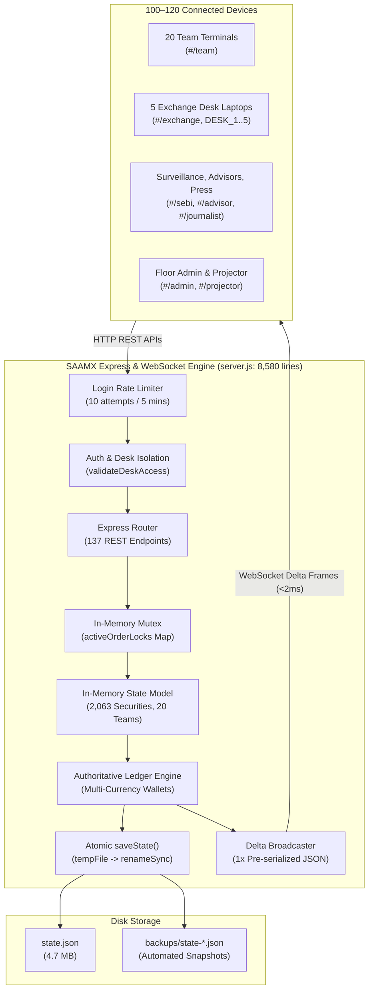

# SAAMX — Backend, API & Data-Integrity Audit (Phase 5)

**Document Version:** 1.0.0  
**Phase:** 5 — Comprehensive Event-Readiness Audit  
**Date:** 2026-10-13  
**Auditor & Engineering Lead:** SAAMX Lead Coding Agent  
**Backend Target File:** `server.js` (8,580 lines, 348.5 KB)  

---

## 1. Executive Summary

This document presents a comprehensive, line-by-line architectural and security audit of the SAAMX backend server (`server.js`), its 137 REST API endpoints, WebSocket event distribution system, authentication and authorization subsystems, trading ledger accounting rules, and state persistence engine.

The server operates as a single-process Node.js Express and WebSocket application maintaining in-memory simulation state synchronized to `state.json`. While Phase 4 successfully hardened dynamic desk assignments, station isolation, and delta broadcasting for 100–120 devices, this audit has uncovered several latent architectural defects, duplicate route registrations, error-masking SPA routing behavior, and legacy hardcoded secrets that must be resolved prior to the live inter-school championship.

---

## 2. Server Architecture Overview



---

## 3. Discovered Defects & Structural Vulnerabilities

### Defect 1: Seven Duplicate Route Registrations in `server.js`
A static AST scan revealed 7 duplicate route declarations where later endpoints either shadow earlier implementations or create conflicting logic:

| # | Route | Line 1 | Line 2 | Severity | Nature of Defect & Conflict |
|:---:|:---|:---:|:---:|:---:|:---|
| **1** | `GET /api/state` | Line 2179 | Line 4099 | **High** | Line 2179 returns sanitized state. Line 4099 returns raw unsanitized state (`res.json(state)`), which would leak password hashes and private holdings if line 2179 were moved or reordered. Line 4099 is currently dead code. |
| **2** | `POST /api/admin/seed` | Line 2563 | Line 6948 | **High** | Line 2563 calls `seedStarterData()`. Line 6948 generates full 2,062 universe and multi-currency wallets. Line 2563 intercepts all calls; line 6948 is unreachable. |
| **3** | `POST /api/admin/reset` | Line 2569 | Line 6980 | **Medium** | Both handle database reset; line 2569 intercepts calls before line 6980's confirmation text validator. |
| **4** | `GET /api/audit-log` | Line 4103 | Line 6943 | **Low** | Redundant duplicate handlers returning identical audit log arrays. |
| **5** | `POST /api/admin/phoenix-act` | Line 6482 | Line 7885 | **Critical** | Line 6482 handles basic news broadcast. Line 7885 handles full `executePhoenixAct()` with projector takeover events. Line 6482 shadows line 7885, breaking projector takeover synchronization! |
| **6** | `POST /api/ipo/advance` | Line 7399 | Line 8447 | **Medium** | Line 7399 handles multi-stage IPO progression. Line 8447 defines redundant fallback handler. |
| **7** | `GET *` | Line 8490 | Line 8562 | **Critical** | Line 8490 catches all unhandled paths and serves `dist/index.html`. Line 8562 (which specifically guards `/api` routes) is completely dead code! |

### Defect 2: SPA Catch-All Masking Unhandled API Routes (HTML Returned for 404s)
In `server.js` line 8490:
```javascript
// SPA router fallback
app.get('*', (req, res) => {
  res.sendFile(path.join(__dirname, 'dist', 'index.html'));
});
```
Because this wildcard catch-all precedes line 8562 and does not check `req.path.startsWith('/api')`:
1. If a client sends a request to an unregistered API endpoint (e.g. `GET /api/unknown-endpoint`), the server returns `dist/index.html` with status **200 OK** instead of **404 Not Found** with a JSON payload.
2. In frontend client code calling `const res = await apiFetch('/api/unknown'); const data = await res.json();`, parsing HTML as JSON throws `SyntaxError: Unexpected token '<', "<!doctype "... is not valid JSON`, crashing component render cycles.

### Defect 3: Hardcoded Master and Role Fallback Passwords
In `server.js` lines 16–17 and 1236–1266:
- Secret strings `MASTER_PASSWORD` (`21112009`) and `PASSWORD_SECRET` (`fms-event-2026`) are hardcoded into server source code.
- A secondary fallback block allows logins using static strings (`saamx-event-2026`, `exchange-event-2026`, `advisor-event-2026`, etc.).
- **Vulnerability:** Anyone inspecting source code or using legacy event credentials can bypass the authoritative `state.personnel` directory and gain unauthorized administrative or desk access.

### Defect 4: Synchronous `saveState()` Disk I/O Blocking
In `server.js` lines 820–835:
```javascript
const saveState = (forceBackup = false) => {
  const dataStr = JSON.stringify(state);
  const tempFile = `${STATE_FILE}.tmp`;
  fs.writeFileSync(tempFile, dataStr, 'utf8');
  fs.renameSync(tempFile, STATE_FILE);
  ...
};
```
- `state.json` is currently **4.7 MB**.
- `saveState()` is called synchronously on every order submission, ticket claim, trade execution, news broadcast, and phase change.
- Performing `fs.writeFileSync` of 4.7 MB synchronously blocks the single-threaded Node.js event loop for 15–35 milliseconds on standard laptops.
- Under peak load with 20 teams submitting paper slips and 5 clerks executing orders concurrently, this creates event-loop latency spikes and delays WebSocket message dispatches.

### Defect 5: Lack of Rollback on Partial Trade Execution Failure
In `server.js` line 5278 (`actionType === 'EXECUTE'`):
- The balance deduction (`team.cashWallets[secCurrency] -= totalValue`) and inventory mutation occur sequentially.
- If a JavaScript runtime exception throws between the cash deduction and order status assignment, the cash balance remains debited in memory while the order remains unexecuted, causing financial ledger discrepancy without transaction rollback.

---

## 4. API Endpoint Catalog (137 Endpoints)

The 137 endpoints in `server.js` span 14 functional domains:

### 4.1 Authentication & Session Management
- `POST /api/auth/login`: Authenticates team or staff; enforces 10-attempt rate limiting; issues scrypt-verified session tokens.
- `GET /api/auth/me`: Validates session token; returns real-time `assignedDesk`, roles, and effective permissions.
- `POST /api/auth/logout`: Invalidates session token on the server.

### 4.2 Personnel & Access Control (RBAC)
- `GET /api/permissions/matrix`: Returns the 37 granular permission definitions across 11 functional groups.
- `GET /api/personnel`: Returns staff directory with passwords and salts sanitized. Requires `personnel.view`.
- `POST /api/personnel`: Provisions new staff member with roles, desk assignment, and permissions. Requires `personnel.create`.
- `PUT /api/personnel/:id`: Updates staff roles, department, assigned desk, and permissions. Requires `personnel.update`.
- `POST /api/personnel/:id/status`: Toggles account status (`ACTIVE` vs `DISABLED`) with instant session revocation.
- `POST /api/personnel/:id/reset-password`: In-app authorized password reset. Requires `personnel.update`.

### 4.3 Desk Assignment & Station Isolation
- `GET /api/desks` (and alias `/api/order-desks`): Returns 5 physical desks, active operators, queue sizes, and assigned teams.
- `POST /api/desks/assign`: Reassigns desk operator or clearance teams; supports `AUTO_BALANCE_TEAMS`.
- `POST /api/order/claim`: Station-isolated claim lock; checks `validateDeskAccess()`; protected by `activeOrderLocks`.

### 4.4 Order Intake, Review & Trade Execution
- `GET /api/orders`: Returns filterable paper order slip queue.
- `POST /api/orders/submit` (aliases `/api/order/create`, `/api/order/submit`): Intake paper slip logging.
- `POST /api/order/action`: Action controller handling `VALIDATE`, `EXECUTE`, `RETURN_FOR_CORRECTION`, `REJECT`.
- `POST /api/orders/resubmit`: Resubmits returned order slip with corrected parameters; enforces team ownership.
- `POST /api/orders/cancel`: Cancels pending slip; enforces team ownership.
- `POST /api/transactions/void`: Voids erroneous trade transaction; reverses cash and holdings. Requires `exchange.void`.

### 4.5 Currency Exchange (Spot FX Desk)
- `GET /api/fx/rates`: Returns live spot conversion rates and spreads.
- `POST /api/fx/rates`: Administrative rate adjustment. Requires `system.config`.
- `GET /api/fx/queue`: Returns pending currency conversion slip requests.
- `POST /api/fx/exchange`: Executes instant currency conversion; debits source wallet, credits target wallet.
- `POST /api/fx/queue-action`: Clearance actions on FX queue tickets (`SETTLE`, `REJECT`).

### 4.6 Market Control & Autonomous Coordinator
- `GET /api/ping`: Server liveness and health monitoring.
- `GET /api/state`: Returns sanitized global state snapshot.
- `POST /api/market/control`: Market session control (`START`, `PAUSE`, `RESUME`, `HALT`). Requires `market.control`.
- `POST /api/sebi/halt`: Halts trading on individual security or market-wide. Requires `sebi.halt`.
- `POST /api/sebi/resume`: Resumes trading on halted security. Requires `sebi.halt`.
- `GET /api/coordinator/status`: Live status of the Asia/Kolkata autonomous coordinator daemon.

### 4.7 Journalism, Press Wire & Scenarios
- `POST /api/news`: Dispatches simulation news bulletins with sentiment and impact metrics. Requires `news.publish`.
- `GET /api/intelligence/feed`: Returns chronological intelligence wire.
- `POST /api/scenarios/manage`: Manages active scenario storylines. Requires `scenarios.trigger`.
- `POST /api/events/trigger`: Triggers Project Phoenix scenario events.

### 4.8 Broker & Advisory Desk
- `POST /api/advisor/refer`: Logs team research referral to advisor desk.
- `GET /api/advisor/referrals`: Returns pending team referrals. Requires `advisor.view`.
- `POST /api/advisor/signal`: Dispatches verified BUY/HOLD/SELL stock signal with rationale. Requires `advisor.signal`.
- `POST /api/broker/bulletin`: Publishes broker research notes. Requires `advisor.signal`.

### 4.9 SEBI Surveillance & Regulatory Penalties
- `GET /api/penalties`: Returns list of regulatory fines and team suspensions.
- `POST /api/penalties/create`: Levies disciplinary fine on team. Requires `sebi.surveil`.
- `POST /api/penalties/appeal`: Team appeals regulatory penalty.
- `POST /api/penalties/resolve-appeal`: Surveillance officer resolves or upholds appeal.

### 4.10 Results, Judging & Scoring Engine
- `GET /api/leaderboard`: Returns real-time 1,000-point multi-factor leaderboard.
- `POST /api/scoring/recalculate`: Triggers full mark-to-market reconciliation and rubric calculation.
- `GET /api/judging/scorecards`: Returns judge deliberation entries. Requires `judging.view`.
- `POST /api/judging/scorecard/save`: Saves deliberation score for a team. Requires `judging.score`.
- `POST /api/results/approve`: Executive committee officially approves results. Requires `results.approve`.
- `POST /api/results/publish`: Releases official results to all participant terminals. Requires `results.approve`.

### 4.11 Participant Registration & Onboarding
- `POST /api/register/complete`: Delegate team registration intake (zero-email/phone).
- `GET /api/admin/registrations`: Returns pending registration queue. Requires `admin`.
- `POST /api/admin/registration/verify`: Approves team and provisions credentials. Requires `admin`.
- `POST /api/admin/participant/lifecycle`: Updates team onboarding state.

### 4.12 Simulated Landmark IPOs
- `GET /api/ipos`: Returns status of 5 landmark IPOs (`OAI`, `STRP`, `CNVA`, `DISC`, `POLY`).
- `POST /api/ipo/bid`: Records team subscription bid for pending IPO.
- `POST /api/ipo/allot`: Floor administrator executes lottery allotment to subscribed teams.
- `POST /api/ipo/stage`: Advances IPO lifecycle (`ANNOUNCED` -> `SUBSCRIPTION` -> `ALLOTMENT` -> `LISTED`).

### 4.13 Audit Trail & Reporting
- `GET /api/audit-log`: Returns chronological immutable system audit trail. Requires `audit.view`.
- `GET /api/reports/orders/csv`: Exports all orders and physical slip records as CSV.
- `GET /api/reports/reconciliation/csv`: Exports complete mark-to-market reconciliation report as CSV.

### 4.14 Disaster Recovery & Administration
- `POST /api/admin/backup`: Manually triggers state snapshot creation in `backups/`.
- `POST /api/admin/restore`: Restores state from a chosen backup snapshot file.
- `POST /api/admin/reset`: Disaster recovery state re-seed; restricted strictly to super-admin Sridhara.

---

## 5. Ledger & Accounting Integrity

### 5.1 Currency Isolation Rules
Trading in foreign securities requires pre-funding the corresponding foreign currency wallet:
- `NSE` Equities $\longrightarrow$ Deducted from `team.cashWallets.INR`.
- `NASDAQ` / `NYSE` Equities $\longrightarrow$ Deducted from `team.cashWallets.USD`.
- `LSE` Equities $\longrightarrow$ Deducted from `team.cashWallets.GBP`.
- `XETRA` Equities $\longrightarrow$ Deducted from `team.cashWallets.EUR`.

If a team attempts a BUY on a US stock without USD funds, the transaction is rejected with HTTP 400: `"Insufficient USD balance"`. Teams cannot automatically overdraft or convert on-the-fly; they must visit the Currency Desk (`#/fx`).

### 5.2 Short Selling Controls
Unless short selling is explicitly enabled by the administrator in `state.riskControls.allowShortSelling`, SELL orders are strictly validated against `team.holdings[ticker]`. If `holding < order.quantity`, the order is rejected with HTTP 400.

### 5.3 Float & Market Impact Algorithm
Every executed order alters the security's available float and moves the market price:
$$\text{Impact Factor} = \frac{\text{Order Quantity}}{\text{Total Units}}$$
$$\Delta P \% = \text{Impact Factor} \times \text{Volatility} \times 100$$
For BUY orders: $P_{\text{new}} = P_{\text{old}} \times (1 + \Delta P\%)$  
For SELL orders: $P_{\text{new}} = \max\left(1, P_{\text{old}} \times (1 - \Delta P\%)\right)$

---

## 6. Concurrency & Mutex Evaluation

### 6.1 In-Memory Mutex (`activeOrderLocks`)
In `server.js` lines 4815 and 4955:
```javascript
if (activeOrderLocks.has(orderId)) {
  return res.status(409).json({ error: 'Order is currently locked by another operation' });
}
activeOrderLocks.set(orderId, session.username);
try {
  ...
} finally {
  activeOrderLocks.delete(orderId);
}
```
**Audit Assessment:**
- **Strengths:** Effectively eliminates double-claim and double-execution race conditions in a single Node.js process. In `test-scalability-120-devices.js`, 20 simultaneous claims resulted in exactly 1 win and 19 conflicts.
- **Weaknesses:**
  - Lacks a TTL expiration. If an unhandled exception or process termination occurs during the try block without entering finally, the lock would persist indefinitely.
  - Bound to a single Node.js event loop; cannot support horizontal clustering across multiple Node.js instances without a distributed lock manager (e.g. Redis). However, for SAAMX's local event host machine deployment topology, single-process mutex is architecturally appropriate.

---

## 7. Persistence & Disaster Recovery Evaluation

### 7.1 Atomic Write Protocol
`saveState()` writes to `${STATE_FILE}.tmp` and then calls `fs.renameSync(tempFile, STATE_FILE)`. On POSIX and modern Windows NTFS, file rename within the same volume is an atomic directory table pointer swap. If the host machine loses power during `saveState()`, the primary `state.json` remains completely uncorrupted.

### 7.2 Automated Snapshots
Snapshots in `backups/` are automatically written every 10 transactions or 60 seconds while the market is Open, and pre-migration snapshots are created on administrative resets. A restore endpoint (`POST /api/admin/restore`) allows one-click recovery to any historical timestamp.

---

## 8. Summary of Backend Hardening Recommendations

1. **Remove the 7 Duplicate Routes:** Consolidate duplicate route registrations, ensuring `Line 7885` Project Phoenix projector takeover logic is active and `Line 4099` raw state leak is deleted.
2. **Fix Catch-All Routing Order:** Place an explicit `/api/*` 404 handler returning JSON `{ error: 'API endpoint not found', path: req.originalUrl }` BEFORE the SPA `app.get('*')` fallback.
3. **Phase Out Hardcoded Credentials:** Restrict all authentication strictly to hashed passwords in `state.personnel` and `state.teams`; remove static fallback passwords from source code.
4. **Implement Rollback on Ledger Mutation:** Wrap order execution mutations in a rollback state snapshot to prevent partial debiting in the event of an unhandled runtime exception.
5. **Debounce `saveState()` Disk Writes:** Introduce a 100ms asynchronous disk write debouncer to avoid multiple synchronous 4.7 MB disk writes in a single second during high-tempo trading bursts.
