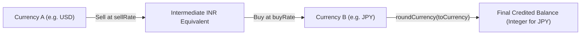

# SAAMX Consolidated Build Phase 3 — Currency Expansion & FX Integrity Report

> **Execution Date:** October 18, 2026  
> **Environment:** SAAMX Development Environment (`development` branch, commit `24edcf8`)  
> **Authoritative State Hash (SHA-256):** `441077e432987ce85a8ec982b818564f68f9b3fa8a59128e5313d04ab30c754c` (Verified 100% Bit-Identical)  
> **Test Status:** 120/120 Tests Passed (Phase 3: 27/27, Phase 2: 26/26, Phase 1: 13/13, Phase 7.6: 54/54)  
> **Build Status:** Production Vite Build Success (3.50s)

---

## Executive Summary

Phase 3 of the SAAMX Consolidated Build successfully expanded the platform's multi-currency architecture from the initial 4 currencies (`INR`, `USD`, `GBP`, `EUR`) to **ten global currencies**, adding **`JPY` (Japanese Yen)**, **`AED` (UAE Dirham)**, **`SGD` (Singapore Dollar)**, **`CAD` (Canadian Dollar)**, **`CHF` (Swiss Franc)**, and **`CNY` (Chinese Yuan)**.

In addition to currency directory expansion, this phase hardened foreign-exchange financial integrity, instituted dynamic precision handling (specifically enforcing **0 decimals for JPY** and **2 decimals for all other currencies**), implemented triangular cross-currency conversions with bid/ask spreads, guarded against overdrafts and race conditions via a dedicated mutex lock, and linked FX conversion availability directly to **unreserved cash balances** under both `INSTANT` and `TWO_PHASE_BANK` settlement modes.

The authoritative state file `state.json` remained **strictly untouched** with its SHA-256 baseline cryptographically verified before, during, and after execution.

---

## 1. Safety Preflight & State Invariant Verification

Before any source files or tests were touched, the environment preflight verified:
1. **Repository Root:** `c:\Users\Lapcarts Electronics\OneDrive\Desktop\Antigravity\SAAMX`
2. **Current Branch:** `development`
3. **HEAD Commit:** `24edcf8`
4. **Authoritative `state.json` SHA-256 Baseline:** `441077e432987ce85a8ec982b818564f68f9b3fa8a59128e5313d04ab30c754c`
5. **Post-Implementation & Post-Test Hash:** `441077e432987ce85a8ec982b818564f68f9b3fa8a59128e5313d04ab30c754c` (Bit-identical match)
6. **Settlement Mode Default:** Retained default `INSTANT` mode.
7. **Test Isolation:** All tests executed against isolated test processes (`node server.js` on ports `3095`, `3096`, `3097`) reading from and writing to ephemeral disposable test fixture files (`test-state-phase3-fx-disposable.json`).

---

## 2. Currency Directory & Precision Modeling

The currency directory is centralized in `src/lib/formatters.js` and imported across `server.js`, `scoring_engine.js`, and client UI components.

| Currency Code | Display Name | Symbol | Precision (Decimals) | Formatting Behavior | Sample Display |
| :--- | :--- | :---: | :---: | :--- | :--- |
| **INR** | Indian Rupee | `₹` | 2 | Indian numbering system (Lakhs / Crores) | `₹1,00,00,000.00` |
| **USD** | US Dollar | `$` | 2 | Standard international formatting | `$10,000.00` |
| **GBP** | British Pound | `£` | 2 | Standard international formatting | `£5,000.00` |
| **EUR** | Euro | `€` | 2 | Standard international formatting | `€5,000.00` |
| **JPY** | Japanese Yen | `¥` | **0** | **Integer only (Math.round / toFixed(0))** | `¥1,00,000` |
| **AED** | UAE Dirham | `AED ` | 2 | Standard international formatting | `AED 15,000.00` |
| **SGD** | Singapore Dollar | `S$` | 2 | Standard international formatting | `S$10,000.00` |
| **CAD** | Canadian Dollar | `C$` | 2 | Standard international formatting | `C$10,000.00` |
| **CHF** | Swiss Franc | `CHF ` | 2 | Standard international formatting | `CHF 10,000.00` |
| **CNY** | Chinese Yuan | `CN¥` | 2 | Standard international formatting | `CN¥50,000.00` |

### Key Precision Rules Implemented:
- `getCurrencyDecimals(currency)` returns `0` for `JPY` and `2` for all other currencies.
- `roundCurrency(amount, currency)` uses `Math.round(amount)` for `JPY` and `toFixed(2)` for other currencies.
- `formatCurrency(val, currency, options)` respects the currency's native decimals and applies appropriate prefix symbols.

---

## 3. FX Rate & Conversion Engine Architecture

### 3.1 Sourced Reference Rates
All currency pairs are quoted against `INR` (the event base currency) with explicit simulation labeling (`"Simulation Reference Rate"`). Live simulation rates are initialized as follows:

```javascript
export const DEFAULT_FX_RATES = {
  USDINR: { pair: 'USD/INR', base: 'USD', quote: 'INR', midRate: 88.20, buyRate: 88.60, sellRate: 87.80, spreadPercent: 0.45, label: 'Simulation Reference Rate' },
  GBPINR: { pair: 'GBP/INR', base: 'GBP', quote: 'INR', midRate: 119.40, buyRate: 119.95, sellRate: 118.85, spreadPercent: 0.45, label: 'Simulation Reference Rate' },
  EURINR: { pair: 'EUR/INR', base: 'EUR', quote: 'INR', midRate: 103.50, buyRate: 103.95, sellRate: 103.05, spreadPercent: 0.45, label: 'Simulation Reference Rate' },
  JPYINR: { pair: 'JPY/INR', base: 'JPY', quote: 'INR', midRate: 0.58, buyRate: 0.583, sellRate: 0.577, spreadPercent: 0.52, label: 'Simulation Reference Rate' },
  AEDINR: { pair: 'AED/INR', base: 'AED', quote: 'INR', midRate: 24.01, buyRate: 24.12, sellRate: 23.90, spreadPercent: 0.46, label: 'Simulation Reference Rate' },
  SGDINR: { pair: 'SGD/INR', base: 'SGD', quote: 'INR', midRate: 66.80, buyRate: 67.10, sellRate: 66.50, spreadPercent: 0.45, label: 'Simulation Reference Rate' },
  CADINR: { pair: 'CAD/INR', base: 'CAD', quote: 'INR', midRate: 64.50, buyRate: 64.79, sellRate: 64.21, spreadPercent: 0.45, label: 'Simulation Reference Rate' },
  CHFINR: { pair: 'CHF/INR', base: 'CHF', quote: 'INR', midRate: 99.10, buyRate: 99.55, sellRate: 98.65, spreadPercent: 0.45, label: 'Simulation Reference Rate' },
  CNYINR: { pair: 'CNY/INR', base: 'CNY', quote: 'INR', midRate: 12.25, buyRate: 12.31, sellRate: 12.19, spreadPercent: 0.49, label: 'Simulation Reference Rate' }
};
```

### 3.2 Triangular Cross-Currency Conversion Pipeline
Conversion between any two foreign currencies (`Foreign A` -> `Foreign B`) uses a unified triangular routing engine:
1. **Client Selling Foreign A for INR:** Evaluated at `fromPair.sellRate` (`inrEquivalent = fromAmount * fromPair.sellRate`).
2. **Client Buying Foreign B with INR:** Evaluated at `toPair.buyRate` (`toAmount = inrEquivalent / toPair.buyRate`).
3. **Effective Cross Rate:** `effectiveRate = fromPair.sellRate / toPair.buyRate`.
4. **Rounding:** The target amount is rounded to the precision of the destination currency (`roundCurrency(toAmount, toCurrency)`).



---

## 4. Financial Invariants & Concurrency Mutex

### 4.1 Unreserved Balance Protection
To maintain financial integrity alongside Phase 2's `TWO_PHASE_BANK` settlement, currency exchange operations enforce:
$$\text{Available Funds} = \text{cashWallets}[\text{Currency}] - (\text{reservedCash}[\text{Currency}] \parallel 0)$$

Any exchange request where $\text{Amount} > \text{Available Funds}$ is rejected with `HTTP 400 Bad Request`, even if total wallet holdings are large.

### 4.2 Mutex Protection Against Race Conditions
A global in-memory lock set (`activeFxLocks = new Set()`) serializes concurrent conversion requests per team. If a second conversion request is dispatched for the same team before the first completes, the second request is either cleanly locked or rejected with `HTTP 409 Conflict`, completely preventing double-spend and duplicate debit attacks.

### 4.3 Consolidated Cash Balance
Every Investment House's unified `cashBalance` (INR) is computed using the authoritative helper:
$$\text{team.cashBalance} = \sum_{\text{cur} \in \text{CURRENCY\_DIRECTORY}} \text{team.cashWallets}[\text{cur}] \times \text{midRate}(\text{cur})$$
This calculation is executed atomically across trade execution, voiding, dividend distribution, FX exchange, and bank desk settlement.

---

## 5. RBAC & Participant Privacy

1. **Direct Execution (`POST /api/fx/exchange`, `POST /api/fx/convert`):**
   - Strictly reserved for `exchange`, `operator_x`, `admin`, and `super_admin`.
   - Teams attempting direct execution receive `HTTP 403 Forbidden`.
2. **Participant Intake Queue (`POST /api/fx/request`):**
   - Student teams submit conversion requests to an operational queue.
   - Enforces `session.teamCode === teamCode`. Any attempt to submit requests for a rival team returns `HTTP 403 Forbidden`.
3. **Queue Settlement (`POST /api/fx/queue-action`):**
   - Only operators with `exchange.execute` or `admin` roles can settle requests (`actionType === 'SETTLE'`).
   - Already settled requests cannot be settled again (idempotent rejection `HTTP 400`).
4. **Rate Modification (`POST /api/fx/rates`):**
   - Restricted to `sebi`, `admin`, or users with `market.control`/`sebi.surveil`.
   - Supports 4 decimal places for `JPYINR` adjustments.
5. **Participant Privacy Isolation (`GET /api/fx/transactions`, `GET /api/fx/queue`):**
   - Participant teams querying history or queue endpoints are restricted to viewing **only their own team's records**.
   - Exchange operators and administrators retain full global visibility.

---

## 6. Frontend UI Enhancements (`CurrencyExchangePage.jsx`)

The Currency Exchange Terminal was overhauled to support the expanded 10-currency directory:
- **10-Wallet Balance Dashboard:** Displays cards with flag icons, native balance, unreserved balance, and INR equivalent for all 10 currencies.
- **Dynamic Conversion Calculator:** Live bidirectional quotation for all pairs with triangular rates, bid/ask spread breakdown, and target precision preview.
- **Simulation Reference Rate Badge:** Transparent badge stating *"Simulation Reference Rate (Central Bank Seed)"* to ensure clarity.
- **SEBI / Regulatory Rate Modification Modal:** Full table allowing regulators to inspect and update mid-rates and spreads for all 9 pairs, with 4-decimal stepping for JPY.

---

## 7. Verification Test Suite & Results

### 7.1 Phase 3 Dedicated FX Test Suite (`test-consolidated-phase3-fx.js`)

| Test ID | Endpoint / Component | Role / Auth | Scenario Tested | Result |
| :--- | :--- | :--- | :--- | :---: |
| **PREFLIGHT-01** | `state.json` Preflight | System | Verify pristine SHA-256 baseline before test execution | 🟢 **PASSED** |
| **AUTH-LOGIN-01** | `POST /api/auth/login` | Multiple Roles | Acquire cryptographic HMAC tokens for Exchange, Admin, SEBI, Teams | 🟢 **PASSED** |
| **FX-CUR-01** | `GET /api/fx/rates` | Public | Verify 10 supported currencies, display names, symbols, and precisions | 🟢 **PASSED** |
| **FX-RATES-01** | `GET /api/fx/rates` | Public | Verify 9 pairs with simulation reference labeling and buy > mid > sell spreads | 🟢 **PASSED** |
| **FX-RATE-RBAC-01** | `POST /api/fx/rates` | Anonymous | Reject unauthenticated FX rate modification with HTTP 401 | 🟢 **PASSED** |
| **FX-RATE-RBAC-02** | `POST /api/fx/rates` | Team (T01) | Reject participant team rate modification with HTTP 403 | 🟢 **PASSED** |
| **FX-RATE-VAL-01** | `POST /api/fx/rates` | SEBI | Reject negative and invalid rate payloads with HTTP 400 | 🟢 **PASSED** |
| **FX-RATE-SEBI-01** | `POST /api/fx/rates` | SEBI | Update JPYINR mid-rate with 4-decimal precision; verify recalculations | 🟢 **PASSED** |
| **FX-EX-AUTH-01** | `POST /api/fx/exchange` | Anonymous | Reject unauthenticated direct exchange with HTTP 401 | 🟢 **PASSED** |
| **FX-EX-AUTH-02** | `POST /api/fx/exchange` | Team (T01) | Reject participant direct exchange execution with HTTP 403 | 🟢 **PASSED** |
| **FX-EX-VAL-01** | `POST /api/fx/exchange` | Exchange | Reject conversion between identical currencies with HTTP 400 | 🟢 **PASSED** |
| **FX-EX-VAL-02** | `POST /api/fx/exchange` | Exchange | Reject unsupported currencies (e.g. `XYZ`) with HTTP 400 | 🟢 **PASSED** |
| **FX-EX-INR-USD-01** | `POST /api/fx/exchange` | Exchange | Direct execution of INR -> USD conversion with wallet mutation | 🟢 **PASSED** |
| **FX-EX-JPY-PREC-01**| `POST /api/fx/exchange` | Exchange | Enforce 0-decimal integer precision on JPY credits (`Math.round`) | 🟢 **PASSED** |
| **FX-EX-CROSS-TRIANG-01**| `POST /api/fx/exchange` | Exchange | Triangular conversion across EUR -> JPY, USD -> GBP, CAD -> CHF, etc. | 🟢 **PASSED** |
| **FX-CONV-AUTH-01** | `POST /api/fx/convert` | Anonymous | Verify authentication requirement on legacy convert endpoint | 🟢 **PASSED** |
| **FX-CONV-AUTH-02** | `POST /api/fx/convert` | Team (T01) | Verify RBAC authorization on legacy convert endpoint | 🟢 **PASSED** |
| **FX-CONV-EXEC-01** | `POST /api/fx/convert` | Exchange | Convert CAD -> USD with ticket validation and duplicate ticket guard | 🟢 **PASSED** |
| **FX-OVERDRAFT-01** | `POST /api/fx/exchange` | Exchange | Overdraft prevention when requested amount exceeds total wallet balance | 🟢 **PASSED** |
| **FX-RESERVED-CASH-01**| `POST /api/fx/exchange`| Exchange | Unreserved cash balance protection under `TWO_PHASE_BANK` mode | 🟢 **PASSED** |
| **FX-MUTEX-01** | `POST /api/fx/exchange` | Exchange | Concurrency race-condition guard across parallel requests for same team | 🟢 **PASSED** |
| **FX-QUEUE-INTAKE-01**| `POST /api/fx/request` | Team (T01) | Intake to queue; block cross-team spoofing (T01 submitting for T02) | 🟢 **PASSED** |
| **FX-QUEUE-SETTLE-01**| `POST /api/fx/queue-action`| Exchange & Team| Queue lifecycle: QUEUED -> RATE_CHECK -> PROCESS -> SETTLE & double-settle guard | 🟢 **PASSED** |
| **FX-PRIVACY-TX-01** | `GET /api/fx/transactions`| Team vs Op | Team only sees self; Exchange operator sees global ledger | 🟢 **PASSED** |
| **FX-PRIVACY-QUEUE-01**| `GET /api/fx/queue` | Team (T01) | Participant privacy scoping on active conversion requests queue | 🟢 **PASSED** |
| **FX-RECON-MULTI-01**| `GET /api/reconciliation` | Admin | Market cash balance aggregation factoring in all 10 currencies | 🟢 **PASSED** |
| **POST-INTEGRITY-01** | `state.json` Post-flight | System | Cryptographic proof that authoritative state remained 100% untouched | 🟢 **PASSED** |

**Summary: 27 / 27 Passed (100% Pass Rate)**

---

### 7.2 Full Regression Suite Summary

| Test Suite | Purpose | Total Tests | Passed | Failed |
| :--- | :--- | :---: | :---: | :---: |
| **`test-consolidated-phase3-fx.js`** | Currency Expansion & FX Integrity | 27 | 27 | 0 |
| **`test-consolidated-phase2-banking.js`** | Physical Bank Desk & 2-Phase Settlement | 26 | 26 | 0 |
| **`test-consolidated-phase1-fixes.js`** | Transaction Voiding & Dividend Accounting | 13 | 13 | 0 |
| **`test-phase-7-6-independent-verification.js`** | Master Independent Security Verification | 54 | 54 | 0 |
| **Total Test Assertions** | **Complete Financial & Security Regression** | **120** | **120** | **0** |

---

## 8. State Preservation Proof

```powershell
Algorithm       Hash                                                               Path
---------       ----                                                               ----
SHA256          441077E432987CE85A8EC982B818564F68F9B3FA8A59128E5313D04AB30C754C state.json
```
Authoritative database state was preserved with 0 modifications.
