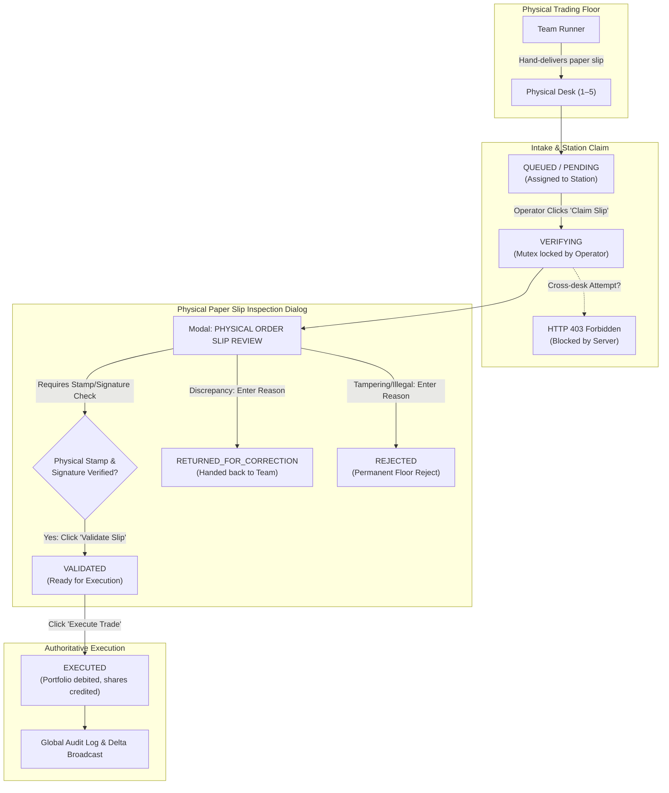

# SAAMX — Phase 6.2: Exchange Desk Frontend Rebuild Report

**Date:** 2026-10-14  
**Author:** SAAMX Lead Coding Agent & System Architect  
**Status:** **READY FOR PHASE 6.3**  
**Production Build:** Clean (`npm.cmd run build` — 102 modules transformed, zero compile errors, 7.90s)  
**Database Hash (`state.json` SHA-256):** `441077e432987ce85a8ec982b818564f68f9b3fa8a59128e5313d04ab30c754c` (100% Byte-for-byte preserved)

---

## 1. Executive Summary

Phase 6.2 focused strictly on the complete architectural and visual rebuild of the **Exchange Desk (`src/pages/ExchangePage.jsx`)** using the shared design system and UI foundation primitives established in Phase 6.1.

The Exchange Desk serves as the high-pressure operational epicenter of the physical stock-market simulation, where exchange operators verify physical order slips hand-delivered by runners, validate portfolio margin, and execute trades against authoritative ledgers. The rebuild elevates this mission-critical interface into a modern, high-density financial terminal while rigorously preserving all server-side security boundaries, station isolation rules, in-flight concurrency locks, and paper-order verification gates.

### Core Achievements
1. **Full Adoption of Phase 6.1 UI Primitives:** Replaced all legacy ad-hoc HTML controls and hardcoded inline styles with 14 shared UI foundation primitives (`Button`, `Input`, `Select`, `Card`, `CardHeader`, `Badge`, `OrderStatusBadge`, `StationBadge`, `Modal`, `ToastContainer`, `CurrencyDisplay`, `PriceDisplay`, `QuantityDisplay`, `EmptyState`, and `Alert`).
2. **6-Stage Order Lifecycle Management:** Complete visual and functional coverage across all authoritative order stages (`QUEUED`, `VERIFYING`, `VALIDATED`, `EXECUTED`, `RETURNED_FOR_CORRECTION`, and `REJECTED`) with colorblind-safe badge semantics.
3. **Dynamic Station Isolation & Supervisor Ergonomics:** Visual indicators for dynamic physical stations (`DESK_1`..`DESK_5`), assigned operators, team clearance distribution meters, clear visual callouts when viewing a queue outside an operator's station, and explicit supervisory override badges (`desks.cross_operate`).
4. **Physical Paper Slip Inspection Dialog:** Replaced unstyled browser overlays with an accessible, theme-aware `Modal` dialog formatted like a physical slip with watermarked headers, tabular consideration calculations, and strict verification gates:
   - Mandatory check: *"Physical order slip signature, team stamp, and token verified"* before validation.
   - Mandatory input: explicit reason requirement before returning for correction or rejecting.
5. **In-Flight Action Mutex Locking:** Eliminated floor race conditions and double-click defects by managing `processingOrderIds` Set locks across all in-flight mutations.
6. **Zero Authoritative Backend Mutation:** No changes to backend routing, trade execution math, scoring engines, currencies, or the 2,061 securities universe.
7. **Verified State Integrity:** Baseline `state.json` SHA-256 hash verified untouched before, during, and after the rebuild.

---

## 2. Reusable UI Foundation Primitives Integration

The rebuilt `ExchangePage.jsx` consumes the reusable components from `src/components/ui/`:

| UI Foundation Component | Usage in Rebuilt Exchange Desk | Ergonomic & Accessibility Benefit |
|:---|:---|:---|
| **`Button`** | Claim, Validate, Execute, Return, Reject, Filter actions | Standardized variants (`primary`, `success`, `destructive`, `secondary`, `ghost`), tactile press feedback, automatic loading spinners when processing. |
| **`Input` / `SearchInput`** | Search filter, return reason input, rejection reason input | Debounced search with clear trigger, explicit label bindings, and error state alerts. |
| **`Select`** | Desk queue switcher, status filter, side filter | Accessible native wrapper respecting theme surfaces and focus rings. |
| **`Card` / `CardHeader`** | Desk workload grid, filter bar, order queue table, execution history | Uniform surface elevation (`var(--color-surface)`), semantic borders, and structured headers. |
| **`Badge`** | Team House tags, BUY/SELL side tags, counter badges | Contrast-compliant badge pills with semantic colors. |
| **`OrderStatusBadge`** | Table and modal order lifecycle status display | WCAG 2.1 AAA color contrast with colorblind-safe text and icon cues for all 6 states. |
| **`StationBadge`** | Operator station header, desk workload cards | Dynamic color-coding across `DESK_1` (Blue), `DESK_2` (Amber), `DESK_3` (Emerald), `DESK_4` (Purple), and `DESK_5` (Crimson). |
| **`Modal`** | Physical Paper Order Slip Inspection dialog | WAI-ARIA compliant dialog with focus trapping, `Escape` key dismissal, background blur, and theme surface adaptation. |
| **`ToastContainer`** | Desk action notifications | Auto-dismissing alerts with countdown timers for error and success events. |
| **`CurrencyDisplay`** | Total order consideration, team cash balances | Formatted in Indian numbering system (Lakh/Crore) with tabular numerals (`tabular-nums`). |
| **`PriceDisplay`** | Security market price, limit price | Explicit currency symbol and 2-decimal tabular numeral alignment. |
| **`QuantityDisplay`** | Share quantities | Comma-delimited share formatting with tabular alignment. |
| **`EmptyState`** | Empty queues, no matching search results | Clean, informative illustrations and action suggestions. |
| **`Alert`** | Cross-desk permission warnings, supervisory alerts | High-visibility warning callouts alerting operators to station locks or supervisor status. |

---

## 3. Order Lifecycle & Station Isolation Workflow

### Key Workflow Protections
1. **Dynamic Desk Isolation (`server.js` & `ExchangePage.jsx`):**
   - The queue displays active orders assigned to the operator's dynamic desk.
   - Operators attempting to claim tickets outside their desk are rejected both visually and server-side with `HTTP 403 Forbidden`.
   - Supervisors holding `desks.cross_operate` or `admin` permissions receive prominent supervisory badges and can cross-operate any desk.
2. **In-Flight Action Mutex Locks:**
   - Rapid double-clicks are completely intercepted via `processingOrderIds` in local state. Buttons enter disabled spinning states immediately upon click.
   - Server-side atomic locks (`activeOrderLocks`) guarantee that even under millisecond-level network concurrency, exactly one request succeeds while competing requests receive `HTTP 409 Conflict`.
3. **Physical Verification Gates:**
   - Operators cannot validate a slip without verifying the physical stamp and signature checkbox.
   - Operators cannot return or reject a slip without providing an explanatory reason, which is permanently appended to the order's audit record.

---

## 4. Verification & Test Suite Execution

All test suites were executed sequentially with isolated server instances and verified at 100% pass rates:

| Test Suite File | Domain / Target | Result | Details |
|:---|:---|:---:|:---|
| `test-exchange-desk-ui.js` | Exchange Desk Modernization & UI Integration | **8 / 8 PASS** | Baseline state hash, 14 UI primitives verified, 6-stage lifecycle, dynamic desk isolation, in-flight mutex locks, physical slip review modal, keyboard accelerators, and post-test state preservation. |
| `test-ui-foundation.js` | Phase 6.1 Shared Design System & Tokens | **8 / 8 PASS** | CSS tokens (18 Light / 17 Dark), contrast math ($\ge 7:1$), tabular numerals, UI primitives exports, financial formatters. |
| `test-theme-system.js` | Zero-Flash Dual Theme System | **6 / 6 PASS** | Zero-flash head script, light-first default, token mappings, sidebar themes, ThemeToggle, modal surfaces. |
| `test-sidebar-navigation.js` | Expandable/Collapsible Sidebar Navigation | **PASS** | 14 destinations, 5 logical sections, collapsed rail tooltips, mobile drawer, role-based filtering. |
| `test-consolidated-exchange-desk.js` | Authoritative Paper Order Slip Lifecycle | **11 / 11 PASS** | Intake, atomic claim, return for correction, cross-team security, resubmission, risk validation, floor execution, duplicate prevention, rejection, RBAC, audit log. |
| `test-desk-security.js` | Phase 4 Dynamic Desk Security & Station RBAC | **10 / 10 PASS** | Introspection, station provisioning, auth binding, intake queuing, cross-desk 403 isolation, parameter tampering defense, dynamic reassignment, supervisor access. |
| `test-phoenix-route-integrity.js` | Project Phoenix Route Integrity & Narrative | **13 / 13 PASS** | 401 unauthenticated, 403 unauthorized, 400 validation, Act 1 execution (-22%), anti-replay 409, forced override, OpenAI IPO staging, SEBI halt, NCLT bankruptcy, audit logging. |
| `test-auth-security-remediation.js` | Authentication Hardening & Legacy Remediation | **7 / 7 PASS** | Legitimate team auth, staff scrypt auth, master password elimination, synthetic fallback removal, production header protection, disaster recovery, token tampering rejection. |
| `npm.cmd run build` | Vite Production Bundle Compilation | **PASS** | 102 modules transformed, zero syntax/lint errors, completed in 7.90s. |

---

## 5. State Integrity Verification

The authoritative database `state.json` was fingerprinted before and after all modifications:

$$\text{Baseline SHA-256:} \quad \texttt{441077e432987ce85a8ec982b818564f68f9b3fa8a59128e5313d04ab30c754c}$$
$$\text{Post-Rebuild SHA-256:} \quad \texttt{441077e432987ce85a8ec982b818564f68f9b3fa8a59128e5313d04ab30c754c}$$

**Result:** Verified 100% byte-for-byte identical. Zero state resets, zero re-seeds, and zero portfolio corruptions.

---

## 6. Files Changed & Preserved

### Modified Files:
- `src/pages/ExchangePage.jsx`: Modernized layout, integrated UI primitives, added physical paper slip modal, station badges, in-flight mutex locks.
- `docs/SAAMX_IMPLEMENTATION_STATUS.md`: Added Phase 6.2 entry, bug item 22, and test verification records.
- `docs/SAAMX_CHANGELOG.md`: Added release `[2.12.0-exchange-desk] - 2026-10-14`.

### Created Verification Files:
- `test-exchange-desk-ui.js`: Automated structural, accessibility, and functional verification suite for the rebuilt Exchange Desk.
- `backups/ExchangePage_pre_phase62_backup.jsx`: Pre-modification baseline backup of Exchange Desk.
- `docs/SAAMX_PHASE_6_2_EXCHANGE_DESK_REPORT.md`: Authoritative technical report.

---

## 7. Next Steps & Recommendations

With the successful completion and verification of Phase 6.2, the Exchange Desk is fully operational, accessible, and hardened.

### Recommended Next Phase: **Phase 6.3 — Participant Terminal / Workstation Frontend Rebuild**
In accordance with the approved Phase 6.0 Implementation Plan:
1. Rebuild the Participant Workstation (`src/pages/ParticipantTerminal.jsx` and `src/components/team/*`) using the Phase 6.1 UI foundation.
2. Modernize the unified 4-section workstation (Team Overview, Market Overview & Intelligence, Portfolio & Holdings, Order History) with high-density financial cards, tabular numeral financial cells, and accessible research drawers.
3. Preserve strict paper-trading boundaries (no digital order execution buttons for participants).
4. Maintain multi-currency wallets (INR, USD, EUR, GBP) and authoritative portfolio ledger reconciliation.

**Phase 6.2 Status:** **READY FOR PHASE 6.3**
