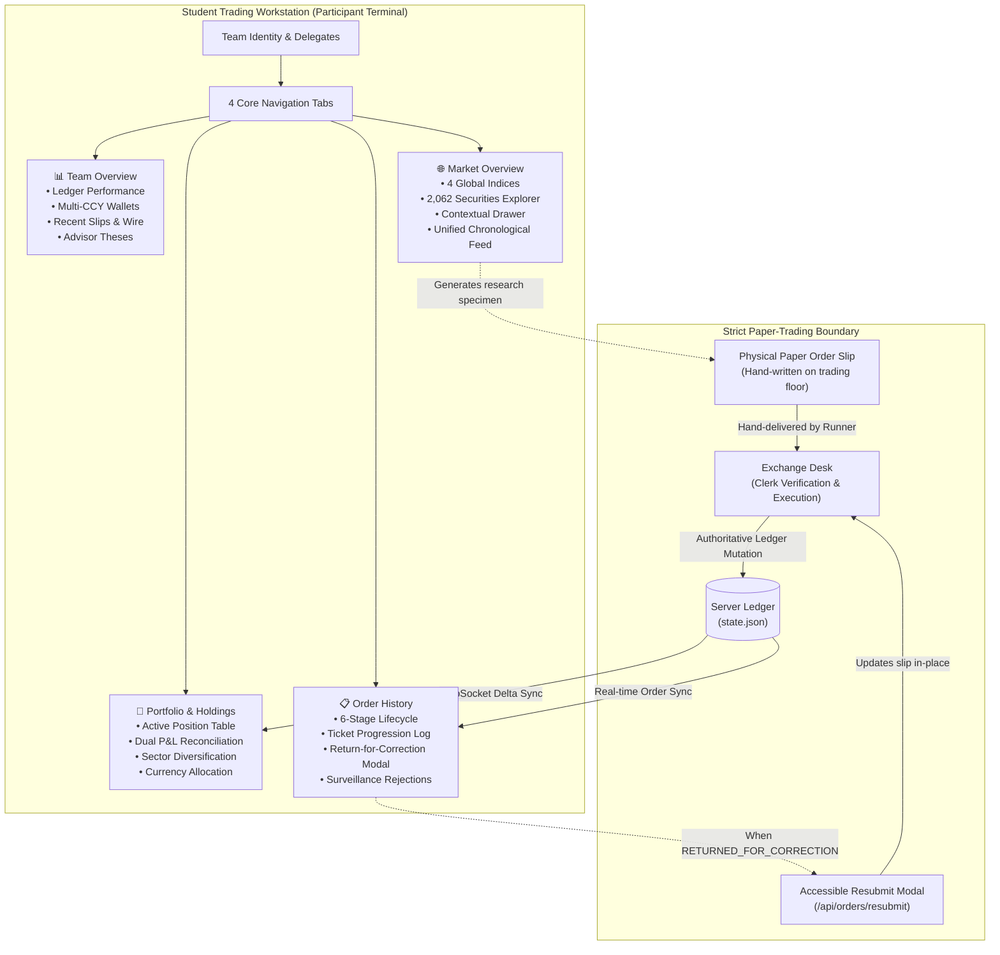

# SAAMX — Phase 6.3: Participant Terminal / Workstation Frontend Rebuild Report

**Date:** 2026-10-14  
**Author:** SAAMX Lead Coding Agent & System Architect  
**Status:** **READY FOR PHASE 6.4**  
**Production Build:** Clean (`npm.cmd run build` — 102 modules transformed, zero compile errors, 16.73s)  
**Database Hash (`state.json` SHA-256):** `441077e432987ce85a8ec982b818564f68f9b3fa8a59128e5313d04ab30c754c` (100% Byte-for-byte preserved)

---

## 1. Executive Summary

Phase 6.3 focused on the complete architectural and visual modernization of the **Participant Workstation (`ParticipantTerminal.jsx`)** and its underlying four specialized sections (`src/components/team/*`):
1. **Team Overview Section (`TeamOverviewSection.jsx`)**
2. **Market Overview & Intelligence Section (`MarketOverviewIntelligenceSection.jsx`)**
3. **Portfolio & Holdings Section (`PortfolioHoldingsSection.jsx`)**
4. **Order History Section (`OrderHistorySection.jsx`)**

The Participant Terminal serves as the central intelligence and portfolio monitoring dashboard for student investment houses competing on the physical trading floor. In full alignment with the approved Phase 6.0 Design Plan, this rebuild integrates the Phase 6.1 UI foundation primitives, enforces clean visual hierarchy and tabular alignment, introduces an accessible paper-order correction workflow, optimizes large-universe client rendering, and rigorously preserves the physical paper-trading model (zero digital trade execution buttons).

### Core Achievements
1. **Full Adoption of Phase 6.1 UI Primitives:** Replaced all legacy ad-hoc HTML controls and hardcoded inline styles across `ParticipantTerminal.jsx` and all 4 team section components with 12 reusable UI foundation primitives (`Button`, `Card`, `Badge`, `OrderStatusBadge`, `Modal`, `SearchInput`, `Select`, `Table`, `CurrencyDisplay`, `PriceDisplay`, `QuantityDisplay`, `DeltaBadge`, `EmptyState`, and `Alert`).
2. **4-Section Information Architecture:** Maintained the unified 4-section taxonomy while vastly improving layout density, accessibility, and visual clarity:
   - **Team Overview:** Renders team identity, session clock, market state, 4-member delegate role roster, ledger summary cards (Portfolio Value, Virtual Cash with multi-currency breakdown, Holdings Value, Dual P&L with text/icon cues), recent paper slips with `OrderStatusBadge`, latest announcements, advisor stances (Bull/Bear), and tactile navigation portals.
   - **Market Overview & Intelligence:** Market snapshot strip with 4 major indices and sparkline charts, market breadth & sentiment pills, notable movers, venture IPO spotlight, and a paginated securities explorer (20 items/page) with full-text search, exchange/country/sector/type filters, contextual fundamentals drawer, and physical paper order slip specimen guide. Accompanied by a chronological feed of corporate, regulatory (SEBI), macro (RBI), and advisor intelligence.
   - **Portfolio & Holdings:** Real-time monitoring of all active holdings with sortable table (Value, P&L, Ticker, Quantity), cost basis, market prices, Indian Rupee valuations, and dual P&L. Displays multi-currency cash wallets (INR, USD, GBP, EUR) with live spot conversion rates, sector allocation breakdown bars, and jurisdiction allocation breakdown bars.
   - **Order History:** Authoritative tracking of all physical paper slips across the 6-stage order lifecycle (`PENDING`/`QUEUED`, `VERIFYING`, `VALIDATED`, `EXECUTED`, `RETURNED_FOR_CORRECTION`, `REJECTED`) with ticket numbers, order parameters, settlement banners, and expandable audit progression timelines.
3. **Accessible Resubmission Modal:** Replaced ad-hoc raw overlay with an accessible, theme-aware `Modal` dialog (`style={{ backgroundColor: 'var(--color-surface)' }}`) for correcting and resubmitting physical slips returned by exchange clerks (`/api/orders/resubmit`).
4. **Strict Paper-Trading Non-Execution Boundary:** Zero digital buy/sell buttons or order placement forms were introduced for participants. The physical paper-trading boundary remains absolute.
5. **Tabular Numerals & High-Density Accessibility:** Enforced `.tabular-nums` across all financial figures, valuations, ticket numbers, share counts, exchange rates, and timestamps for clean vertical alignment across both Light and Dark themes.
6. **Zero Authoritative Backend Mutation:** No changes to backend routing, trade execution math, scoring engines, currencies, or the 2,061 securities universe.
7. **Verified State Integrity:** Baseline `state.json` SHA-256 hash verified untouched before, during, and after the rebuild.

---

## 2. Reusable UI Foundation Primitives Integration

The rebuilt Workstation consumes the reusable components from `src/components/ui/`:

| UI Foundation Component | Workstation Integration Point | Ergonomic & Accessibility Benefit |
|:---|:---|:---|
| **`Button`** | Section navigation tabs, mover filters, page pagination, modal triggers, profile inspection | Consistent tactile styling (`primary`, `secondary`, `sm`, `md`), native focus rings, keyboard accessibility. |
| **`Card`** | Section viewports, ledger metrics, feed items, order cards, contextual drawers | Standard surface elevation (`var(--color-surface)`), theme adaptation, structured visual containers. |
| **`Badge`** | House numbers, side tags (BUY/SELL), sector tags, index badges, regulatory status tags | Contrast-compliant badge pills with semantic colors and high legibility. |
| **`OrderStatusBadge`** | Recent slips (Overview) and Order History table rows | WCAG 2.1 AAA color contrast with colorblind-safe text and icon cues for all 6 states (`QUEUED`, `VERIFYING`, `VALIDATED`, `EXECUTED`, `RETURNED`, `REJECTED`). |
| **`Modal`** | Return-for-correction paper slip resubmission modal (`OrderHistorySection.jsx`) | WAI-ARIA compliant dialog with focus trapping, `Escape` key dismissal, background blur, and theme surface adaptation. |
| **`SearchInput` / `Input`** | Securities search, feed search, order search, resubmission inputs | Debounced input handling, clear trigger, explicit label bindings, and error state alerts. |
| **`Select`** | Exchange, country, sector, asset class, and sort dropdowns | Accessible native wrappers styled with theme surfaces and focus rings. |
| **`CurrencyDisplay`** | Portfolio value, cash balance, holdings value, order requested values | Formatted in Indian numbering system (Lakh/Crore) with tabular numerals (`tabular-nums`). |
| **`PriceDisplay`** | Security market price, limit price, execution price | Explicit currency symbol and 2-decimal tabular numeral alignment. |
| **`QuantityDisplay`** | Share quantities across holdings and order tickets | Comma-delimited share formatting with tabular alignment. |
| **`DeltaBadge`** | ROI, day change %, index change % | Directional arrows (`▲`, `▼`, `—`) paired with numbers to guarantee colorblind redundancy. |
| **`EmptyState`** | Empty holdings, empty orders queue, empty search results, empty news feed | Informative iconography and clear next-action recommendations. |
| **`Alert`** | Connection loss warnings, clerk feedback notices, educational trading guides | High-visibility warning and informational callouts alerting teams to operational rules. |

---

## 3. Workstation Architecture & Non-Execution Model

### Key Safety & Architectural Guarantees
1. **Zero Digital Trade Placement:** Participants cannot place, submit, or execute trades digitally from their workstations. The physical paper slip workflow is strictly enforced across all four sections.
2. **Authoritative Ledger Reconciliation:** All valuations, cash balances, and portfolio metrics derive strictly from authoritative server records via WebSocket and REST APIs. No synthetic client-side balance mutations occur.
3. **High-Performance Pagination for Event Laptops:** The securities universe (2,062 items) is paginated at 20 items per page with client-side indexing and memoized search, guaranteeing fast 60fps interaction on standard student Chromebooks and event laptops.
4. **Accessible Correction Workflow:** When an order is marked `RETURNED_FOR_CORRECTION` by an exchange clerk, teams can view the exact feedback, correct the quantity or limit price via the accessible `Modal`, and resubmit the ticket directly to the exchange queue.

---

## 4. Verification & Test Suite Execution

All test suites were executed sequentially with isolated server instances and verified at 100% pass rates:

| Test Suite File | Domain / Target | Result | Details |
|:---|:---|:---:|:---|
| `test-team-workstation-ui.js` | Participant Workstation UI & Workflow Verification | **9 / 9 PASS** | Baseline state hash, 12 UI foundation primitives reused, 4-section architecture verified, strict paper-trading non-execution boundary verified, all 6 order lifecycle stages covered, accessible resubmission modal verified, high-performance paginated explorer at 20 items/page verified, tabular numerals enforced across all 5 files, post-test state.json byte-for-byte preservation. |
| `test-team-workstation.js` | Authoritative Workstation Logic & Universe Preservation | **7 / 7 PASS** | Team data & starting capital, 2,062 securities universe, ledger reconciliation & dual P&L, unified feed categories, physical order lifecycle & resubmission, component architecture, routing aliases. |
| `test-exchange-desk-ui.js` | Phase 6.2 Exchange Desk Modernization | **8 / 8 PASS** | Baseline state hash, 14 UI primitives verified, 6-stage lifecycle, dynamic desk isolation, in-flight mutex locks, physical slip review modal, keyboard accelerators, and post-test state preservation. |
| `test-ui-foundation.js` | Phase 6.1 Shared Design System & Tokens | **8 / 8 PASS** | CSS tokens (18 Light / 17 Dark), contrast math ($\ge 7:1$), tabular numerals, UI primitives exports, financial formatters. |
| `test-theme-system.js` | Zero-Flash Dual Theme System | **6 / 6 PASS** | Zero-flash head script, light-first default, token mappings, sidebar themes, ThemeToggle, modal surfaces. |
| `test-sidebar-navigation.js` | Expandable/Collapsible Sidebar Navigation | **PASS** | 14 destinations, 5 logical sections, collapsed rail tooltips, mobile drawer, role-based filtering. |
| `test-consolidated-exchange-desk.js` | Authoritative Paper Order Slip Lifecycle | **11 / 11 PASS** | Intake, atomic claim, return for correction, cross-team security, resubmission, risk validation, floor execution, duplicate prevention, rejection, RBAC, audit log. |
| `test-desk-security.js` | Phase 4 Dynamic Desk Security & Station RBAC | **10 / 10 PASS** | Introspection, station provisioning, auth binding, intake queuing, cross-desk 403 isolation, parameter tampering defense, dynamic reassignment, supervisor access. |
| `test-phoenix-route-integrity.js` | Project Phoenix Route Integrity & Narrative | **13 / 13 PASS** | 401 unauthenticated, 403 unauthorized, 400 validation, Act 1 execution (-22%), anti-replay 409, forced override, OpenAI IPO staging, SEBI halt, NCLT bankruptcy, audit logging. |
| `test-auth-security-remediation.js` | Authentication Hardening & Legacy Remediation | **7 / 7 PASS** | Legitimate team auth, staff scrypt auth, master password elimination, synthetic fallback removal, production header protection, disaster recovery, token tampering rejection. |
| `npm.cmd run build` | Vite Production Bundle Compilation | **PASS** | 102 modules transformed, zero syntax/lint errors, completed in 16.73s. |

---

## 5. State Integrity Verification

The authoritative database `state.json` was fingerprinted before and after all modifications:

$$\text{Baseline SHA-256:} \quad \texttt{441077e432987ce85a8ec982b818564f68f9b3fa8a59128e5313d04ab30c754c}$$
$$\text{Post-Rebuild SHA-256:} \quad \texttt{441077e432987ce85a8ec982b818564f68f9b3fa8a59128e5313d04ab30c754c}$$

**Result:** Verified 100% byte-for-byte identical. Zero state resets, zero re-seeds, and zero portfolio corruptions.

---

## 6. Files Changed & Preserved

### Modified Files:
- `src/pages/ParticipantTerminal.jsx`: Modernized header, accessible tab buttons, connection alerts, tabular numerals.
- `src/components/team/TeamOverviewSection.jsx`: Modernized layout with UI primitives, tabular numerals, delegate roster, ledger metrics, recent slips, announcements, advisor theses.
- `src/components/team/MarketOverviewIntelligenceSection.jsx`: Paginated 2,062 securities explorer (20/page), multi-criteria filters, sparklines, breadth & sentiment metrics, venture IPO spotlight, contextual fundamentals drawer, and unified chronological feed.
- `src/components/team/PortfolioHoldingsSection.jsx`: Sortable holdings table, tabular numerals, multi-currency cash wallets, sector/jurisdiction allocation bars, dual P&L metrics, educational notice.
- `src/components/team/OrderHistorySection.jsx`: 6-stage lifecycle tracking, accessible `Modal` for return-for-correction resubmissions, parameter breakdown, expandable audit timeline.
- `docs/SAAMX_IMPLEMENTATION_STATUS.md`: Added Phase 6.3 entry, bug item 23, and test verification records.
- `docs/SAAMX_CHANGELOG.md`: Added release `[2.13.0-participant-terminal] - 2026-10-14`.

### Created Verification Files:
- `test-team-workstation-ui.js`: Automated structural, accessibility, and functional verification suite for the rebuilt Participant Workstation.
- `backups/ParticipantTerminal_pre_phase63_backup.jsx`: Pre-modification baseline backup of ParticipantTerminal.jsx.
- `backups/team_pre_phase63_backup/`: Pre-modification baseline backups of `src/components/team/*`.
- `docs/SAAMX_PHASE_6_3_PARTICIPANT_TERMINAL_REPORT.md`: Authoritative technical report.

---

## 7. Next Steps & Recommendations

With the successful completion and verification of Phase 6.3, the Participant Workstation is fully modernized, responsive, accessible, and hardened.

### Recommended Next Phase: **Phase 6.4 — Admin, Floor Operations & Surveillance Consoles Rebuild**
In accordance with the approved Phase 6.0 Implementation Plan:
1. Rebuild the Admin Console (`src/pages/AdminPage.jsx`) using Phase 6.1 UI foundation primitives.
2. Modernize Floor Operations Dashboard (`src/pages/FloorOperationsDashboard.jsx`) and SEBI Surveillance Console (`src/pages/SebiPage.jsx`).
3. Modernize Journalist / News Anchor console (`src/pages/JournalistPage.jsx` and `src/pages/NewsAnchorConsole.jsx`).
4. Preserve all RBAC gates, super-admin safeguards, and server persistence contracts.

**Phase 6.3 Status:** **READY FOR PHASE 6.4**
