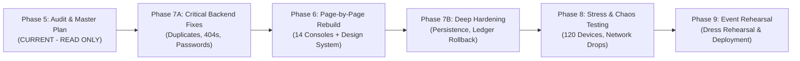

# SAAMX — Rebuild & Release Master Roadmap (Phases 5 – 9)

**Document Version:** 1.0.0  
**Phase:** 5 — Comprehensive Event-Readiness Audit  
**Date:** 2026-10-13  
**Auditor & Technical Director:** SAAMX Lead Coding Agent  
**Event Scale:** 20 High-School Investment Houses (100–120 Devices)  

---

## 1. Master Strategy & Phasing Architecture

This roadmap defines the authoritative, step-by-step master plan to transition the SAAMX simulation platform from the completed Phase 5 audit baseline to production-ready live event deployment.

The implementation is structured across five sequential, safety-guarded phases:

> [!IMPORTANT]
> **Architecture Sequencing Principle:** Critical backend vulnerabilities (duplicate route shadowing and SPA API 404 masking) must be addressed in Phase 7A **before** rebuilding dependent frontend pages in Phase 6. This guarantees that frontend refactoring integrates with clean, predictable API contracts.

---

## 2. Phase-by-Phase Execution Specifications

### Phase 5 — Comprehensive Event-Readiness Audit (Current Phase)
- **Status:** **ACTIVE / IN PROGRESS**
- **Objective:** Evidence-based inspection of all frontend pages, backend routes, authentication flows, data structures, and load capabilities without modifying production state.
- **Deliverables:**
  1. `SAAMX_PHASE_5_EVENT_READINESS_AUDIT.md` (Master Audit Report)
  2. `SAAMX_PAGE_INVENTORY.md` (Complete 20-Page & Console Inventory)
  3. `SAAMX_API_AND_BACKEND_AUDIT.md` (Backend & 137 REST Endpoints Audit)
  4. `SAAMX_EVENT_DAY_RISK_REGISTER.md` (Prioritized 10-Risk Matrix)
  5. `SAAMX_REBUILD_AND_RELEASE_ROADMAP.md` (This Sequenced Master Roadmap)
- **Completion Criteria:** All 11 baseline test suites executed with 100% pass record; zero bytes modified in `state.json`; comprehensive documentation approved.

---

### Phase 7A — Critical Backend Contract Fixes (Pre-Rebuild Prerequisite)
- **Objective:** Eliminate route collisions and error-masking behavior in `server.js` before frontend refactoring commences.
- **Scope:**
  1. **Remove 7 Duplicate Routes in `server.js`:**
     - Delete dead `GET /api/state` at Line 4099.
     - Delete dead `POST /api/admin/seed` at Line 2563; activate Line 6948 multi-currency universe generator.
     - Remove duplicate Line 6482 `phoenix-act`; activate Line 7885 `executePhoenixAct()` with projector takeover events.
     - Consolidate Line 7399 and Line 8447 `POST /api/ipo/advance`.
  2. **Implement Explicit API 404 Handler:**
     - Insert `app.all('/api/*', (req, res) => res.status(404).json({ error: 'API endpoint not found', path: req.originalUrl }))` immediately before the SPA fallback.
  3. **Phase Out Hardcoded Master Secrets:**
     - Remove static passwords (`MASTER_PASSWORD`, `PASSWORD_SECRET`, legacy role strings); enforce all logins strictly against `state.personnel` and `state.teams`.
- **Prerequisites:** Phase 5 Audit Approval.
- **Deliverables:** Hardened `server.js` with clean route registration.
- **Verification Tests:** Unit tests verifying API 404 returns JSON; adversarial login test verifying static passwords are rejected; Project Phoenix act triggering test.

---

### Phase 6 — Page-by-Page Frontend Rebuild & Design System Unification
- **Objective:** Rebuild and polish every frontend page sequentially, eliminating inline styling, decomposing monolithic files, improving responsive behavior, and removing legacy Firebase SDK coupling.
- **Proposed Page-by-Page Rebuild Order:**

```mermaid
flowchart TD
    Page1["1. LoginPage (#/login)\nClean JWT auth, error banners, rate limiting"] --> Page2["2. ExchangePage (#/exchange)\nDecompose modals, station lock, keyboard speed"]
    Page2 --> Page3["3. ParticipantTerminal (#/team)\nVirtualize 2,062 securities, optimize feed"]
    Page3 --> Page4["4. FloorOperationsDashboard (#/floor-ops)\nAdd live connected client meter, phase clock"]
    Page4 --> Page5["5. CurrencyExchangePage (#/fx)\nPreset lot buttons, design token harmonization"]
    Page5 --> Page6["6. SebiPage (#/sebi)\nStrip direct Firebase imports, pure apiFetch"]
    Page6 --> Page7["7. JournalistPage & Anchor (#/journalist)\nStep player safety rollback, teleprompter contrast"]
    Page7 --> Page8["8. BrokerAdvisoryTerminal (#/advisor)\nStructured valuation metrics, non-execution banner"]
    Page8 --> Page9["9. MarketWatchPage (#/market-watch)\nVirtualize table, memoize SVG sparklines"]
    Page9 --> Page10["10. ProjectorPage (#/projector)\n60fps GPU acceleration, 4K projector scaling"]
    Page10 --> Page11["11. ResultsPage (#/results)\nStaged deliberation view, CSV export"]
    Page11 --> Page12["12. PortfolioPage (#/portfolio)\nSummary metrics, CSV export for floor judges"]
    Page12 --> Page13["13. RegistrationPage (#/register)\nPrinted slip formatting, zero-email validation"]
    Page13 --> Page14["14. AdminPage (#/admin)\nDecompose into 5 modular tab components"]
```

#### Rebuild Standards per Page:
1. **Design Tokens Compliance:** 100% of surfaces, borders, text, and badges must use SAAMX CSS variables (`var(--color-surface)`, `var(--color-surface-2)`, `var(--color-ink)`, `var(--color-brass)`).
2. **State Decoupling:** Pages must read state strictly through props or dedicated context, avoiding direct Firebase Realtime Database subscriptions.
3. **Responsive Breakpoints:** All tables and consoles must render cleanly across Desktop ($\ge 1280\text{px}$), Laptop ($1024\text{px} - 1279\text{px}$), and Tablet ($768\text{px} - 1023\text{px}$).
4. **Virtualization:** High-density tables exceeding 100 rows (`MarketWatchPage`, `ParticipantTerminal`) must use virtualized rendering.
5. **No Regressions:** Every page rebuild must be verified against existing test suites before proceeding to the next page.

---

### Phase 7B — Deep Backend Hardening, Concurrency & Ledger Reliability
- **Objective:** Finalize backend business logic, transaction atomicity, persistence debouncing, and memory leak defense.
- **Scope:**
  1. **Ledger Transaction Rollback Wrapper:** Wrap `POST /api/order/action` (EXECUTE) in a snapshot restore mechanism to prevent partial balance debits if an unhandled exception occurs.
  2. **Debounced State Persistence:** Introduce a 100ms asynchronous write debouncer for `saveState()` to prevent event-loop stalls under rapid consecutive slip entries.
  3. **Mutex Lock TTL Timeout:** Equip `activeOrderLocks` with a 15-second expiration timer to automatically recover from hung order locks.
  4. **Multi-Currency Float Reconciliation Daemon:** Implement an automated sanity checker verifying that total team cash balances match the aggregate starting capital of ₹20 Crores minus net executed transactions.
- **Prerequisites:** Phase 6 Frontend Rebuild.
- **Verification Tests:** Automated chaos testing; ledger reconciliation sanity check.

---

### Phase 8 — Integration, Stress & Chaos Testing (100–120 Devices)
- **Objective:** Subject the fully integrated frontend and hardened backend to realistic trading floor concurrency, network packet loss, and operational disruptions.
- **Test Scenarios:**
  1. **120-Device Concurrent Event Simulation:**
     - 20 teams (80 delegate devices) viewing live market watch and submitting paper slips.
     - 5 exchange clerks actively claiming and executing slips.
     - Surveillance officers monitoring circuit breakers.
     - Press journalists dispatching breaking news wire bulletins.
     - Verify server memory stays under 250 MB and average WebSocket latency remains $<5\text{ms}$.
  2. **Network Dropout & Automated Reconnection:**
     - Abruptly terminate Wi-Fi connections on 30 devices simultaneously; verify seamless automatic reconnect and state re-synchronization within 3 seconds.
  3. **Mid-Session Server Restart & Recovery:**
     - Simulate host power failure; restart server; verify `state.json` loads without lost orders, corrupted balances, or broken personnel sessions.
  4. **Duplicate Submission & Race Condition Defense:**
     - Flood the intake endpoint with 50 duplicate ticket submissions; verify 100% rejection without duplicate ledger alteration.
- **Prerequisites:** Phase 7B Completion.
- **Completion Criteria:** Zero ledger discrepancies, zero unhandled server exceptions, 100% pass across all regression test suites.

---

### Phase 9 — Live Event Deployment & Rehearsal Runbook
- **Objective:** Authoritative operational readiness, physical hall setup, staff briefing, and dress rehearsal execution.
- **Deployment Checklist & Timeline:**

| Time / Stage | Operational Activity | Responsible Role | Verification Method |
|:---|:---|:---:|:---|
| **T - 24 Hours** | Full disaster recovery snapshot created in `backups/` | Systems Admin | Hash verification of `state.json` |
| **T - 3 Hours** | Host laptop running `server.js` connected to dedicated local gigabit router | Technical Lead | Static IP configured (`192.168.1.100`) |
| **T - 2 Hours** | Physical clearance desks labeled `Desk 1` through `Desk 5` with 1 laptop each | Floor Coordinator | Clerks log in and test station lock |
| **T - 90 Mins** | Main auditorium projector connected to `#/projector` | AV Specialist | Verify split-flap board and news takeover |
| **T - 60 Mins** | Staff onboarding briefing (clerks, journalists, SEBI, advisors, judges) | Floor Director | Role credentials issued; test login |
| **T - 30 Mins** | Delegate teams arrive; registration credentials printed; clearance desks assigned | Onboarding Clerk | Teams log in to `#/team` on student laptops |
| **T - 0 (09:30)** | Opening Bell rings; continuous paper trading begins | Floor Director | Exchange clock active; slips intake flowing |
| **15:30** | Closing Bell rings; trading halts automatically; valuation freeze | Autonomous Daemon | Ledger freeze verified; scoring engine runs |
| **16:00** | Judging deliberations conclude; official championship results published | Executive Committee | Winner podium displayed on projector |

---

## 3. Live Event Day Contingency Plans

### Contingency 1: Local Wi-Fi Network Outage
- **Trigger:** High device density causes local Wi-Fi router packet drops.
- **Procedure:**
  1. The 5 Exchange Desk laptops and Host laptop are hardwired via physical Ethernet cables to an unmanaged gigabit switch.
  2. If delegate Wi-Fi degrades, paper slip intake continues uninterrupted at the physical exchange desks.
  3. Once Wi-Fi recovers, participant terminals automatically pull the latest state snapshot.

### Contingency 2: Accidental Database Reset / Corruption
- **Trigger:** Unintended state re-seed or hardware failure.
- **Procedure:**
  1. Super-admin navigates to `#/admin` $\longrightarrow$ `Event Controls` $\longrightarrow$ `Disaster Recovery`.
  2. Selects the most recent automated snapshot from `backups/state-*.json`.
  3. Clicks "Restore Snapshot"; server restores complete balances, holdings, and order history within 1.5 seconds.

### Contingency 3: Physical Clearance Desk Queue Bottleneck
- **Trigger:** Heavy burst of paper slip submissions overwhelms Desk 1 and Desk 2.
- **Procedure:**
  1. Floor Supervisor opens `#/floor-ops` or `#/admin` $\longrightarrow$ `Personnel`.
  2. Dynamically reassigns surplus teams from Desk 1 to Desk 4 and Desk 5.
  3. Floor supervisor uses cross-desk authority (`desks.cross_operate`) to assist with clearing the queue without station reassignment.

---

## 4. Acceptance Criteria for Final Event Sign-Off

The SAAMX platform will be certified **100% Event-Ready** only when all of the following conditions are met:

1. [ ] All 7 duplicate routes in `server.js` are eliminated.
2. [ ] API 404 handler returns clean JSON instead of SPA HTML.
3. [ ] Hardcoded legacy passwords are removed; 100% of authentication uses `scrypt` hashes.
4. [ ] All 14 frontend pages render using design tokens with zero console warnings.
5. [ ] 120-device concurrent stress test passes on physical local network hardware.
6. [ ] Rehearsal simulation completes full 09:30 to 15:30 cycle with zero ledger balance discrepancies.
7. [ ] Physical paper slip workflow verified with zero participant-side execution bypasses.
